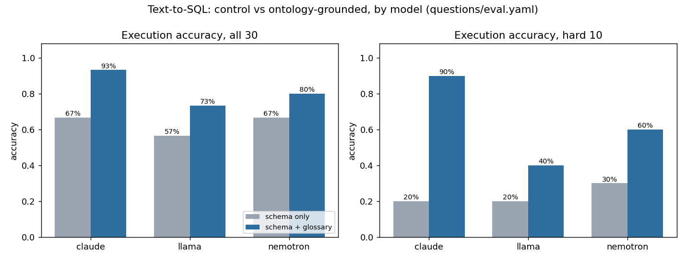
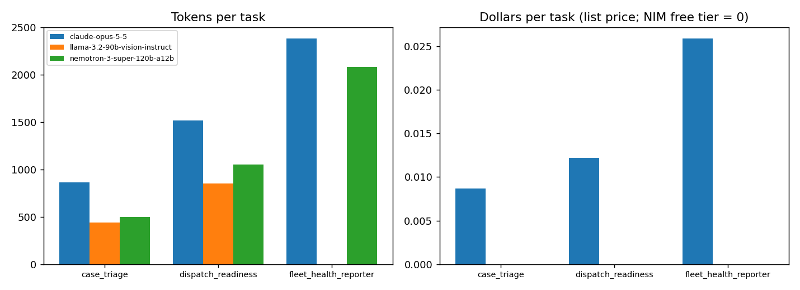

# knowledge-agents-pilot

Project 3 of 3: three governed Knowledge Agents that do Services Operations work on top of NVIDIA
Auto Ontology, Elasticsearch and MCP. Each comes with the evaluation, cost record and program
paperwork a technical program manager needs to decide whether to scale it.

## Why this shape

The enterprise AI data platforms announced across the industry in 2026 describe **Knowledge
Agents**: agents on a curated slice of a knowledge graph, with owner-set prompt guidance, data
access permissions, quality guardrails and token cost thresholds, running the same on open and
closed models. The operating model: agents do the work, and humans come back in to review or
approve when it matters. I built a small, measured version of that on Project 1's warehouse
(`services-ops-intelligence`) and its risk model:

| Platform piece | Here |
|---|---|
| Unified Semantic Layer, extendable with NVIDIA Auto Ontology | NVIDIA Auto Ontology (pinned 2026-10-15) ingests the warehouse: 26 tables, 221 columns, a compiled semantic layer of 26 terms, NL-to-SQL with provenance through its API. A 20-term glossary (`questions/glossary.yaml`) is the agents' owner-set guidance. I pushed it into Auto Ontology's term definitions through its management API (`kap.eval.ao_enrich`) |
| Data Search Engine (hybrid keyword + vector) | Elasticsearch 8 with BM25 and NeMo Retriever embeddings (`nvidia/nemotron-3-embed-1b` via NIM), joined by reciprocal rank fusion, over 22 runbooks and 500 case notes |
| Context handed to models through MCP | `kap.mcp_server` (MCP Python SDK 2.x) exposes `sql_query` (read-only, allow-listed, row-capped), `search_runbooks`, `asset_history`, `parts_on_hand` and `fleet_risk`. Every call is audited |
| Knowledge Agents with permissions, guardrails, cost thresholds | three agents, each a YAML config: model, tools it may call, tables it may see, quality threshold, token budget, model-call cap. One adapter covers Nemotron and Llama (NIM) and Claude (Anthropic) |
| Humans review or approve | the triage agent escalates below its threshold. Dispatch readiness only advises, and goes conservative on disagreement. The fleet reporter drafts, and publishes nothing without a named approver |
| Evaluation and governance | a 30-question text-to-SQL set with ground truth, two arms, BIRD execution match. 10 scenarios per agent against Project 1's truth files. Prompt-injection tests, an audit log and a cost dashboard |

## What is real and what is generated

- Real: the drive telemetry under everything (Backblaze 2026 Q2 via Project 1), the risk scores
  (Project 1's LightGBM, 30-day), NVIDIA Auto Ontology, the models, the latencies and token counts.
- Generated (Project 1, seeded, with documented mess and ground truth): accounts, sites, assets,
  cases, dispatches, parts, inventory, technicians, runbooks. Case text is templated. Every agent
  scenario's expected outcome comes from Project 1's `truth/` files, which is what makes the agent
  numbers checkable at all. Details are in `docs/DATA.md`.
- Not real: dollar costs on NIM. The free developer tier bills nothing, so NIM rows say $0 and
  report tokens. Claude rows use Anthropic list price (`questions/pricing.yaml`).

## Measured results (2026-10-17)

Every number below is printed by code in this repository and lives in `reports/`. Model ids and
pins are in `docs/VERSIONS.md`. Three of the planned model ids were end-of-life on the hosted
catalog before the build started, so I replaced them (`program/DECISIONS.md`, item 3).

### Text-to-SQL: schema-only control vs ontology-grounded (`reports/eval_results.csv`)

30 questions: 10 easy, 10 medium, 10 hard, where a business definition decides the answer. One
repair turn per arm, scored by execution match (`set(gold) == set(pred)`, the BIRD rule NVIDIA's
ontology-sql-eval uses). The ontology arm is the same prompt plus the glossary, so the delta is
the semantic layer's.

| Model | Arm | All 30 | Easy | Medium | Hard 10 | SQL errors | Mean model latency | Tokens in / out | Cost |
|---|---|---:|---:|---:|---:|---:|---:|---:|---:|
| nemotron (nvidia/nemotron-3-super-120b-a12b, reasoning on) | schema only | 66.7% | 80% | 90% | 30% | 0 | 13.8 s | 30,510 / 12,476 | $0 |
| nemotron | schema + glossary | 80.0% | 90% | 90% | 60% | 0 | 13.3 s | 77,113 / 15,542 | $0 |
| llama (meta/llama-3.2-90b-vision-instruct) | schema only | 56.7% | 90% | 60% | 20% | 2 | 33.5 s | 32,705 / 1,800 | $0 |
| llama | schema + glossary | 73.3% | 100% | 80% | 40% | 1 | 17.0 s | 85,380 / 2,387 | $0 |
| claude (claude-opus-5-5, effort medium) | schema only | 66.7% | 90% | 90% | 20% | 0 | 2.8 s | 45,643 / 5,556 | $0.29 |
| claude | schema + glossary | 93.3% | 100% | 90% | 90% | 0 | 2.7 s | 117,553 / 5,516 | $0.58 |

**Headline: on the hard ten, the glossary moved Claude from 2/10 to 9/10, Nemotron from 3/10 to
6/10 and Llama from 2/10 to 4/10.** Without the semantic layer every model sits at 20 to 30% on
questions where a definition decides the answer (two timestamp formats, repeat dispatch,
deflectable case, warranty unknowns, serial prefixes, service vs telemetry failure). The schema
alone does not carry those meanings. The context costs about 2.6x the input tokens. Easy and
medium questions barely move, which is what a semantic layer should do. Latency for the NIM
models includes free-tier throttling and retries (`KAP_NIM_RPM`), so it is not a model benchmark.
Claude's is a clean API latency. Caveats: 30 questions, generated data, and one author's glossary
written against the same schema. A glossary tuned to the question set is the obvious confound. I
wrote it from Project 1's schema and mess rules before running any question, and corrected it once
before the ontology arm ran (`program/DECISIONS.md` item 11, the case-insensitive serial join).
But I also wrote the questions.



I ran NVIDIA Auto Ontology's own pipeline (Nemotron, its default flow) through its API twice,
because each question takes 1.5 to 9 minutes on the free NIM tier shared with the matrix above
(`reports/auto_ontology_smoke.md`, `reports/auto_ontology_rerun.csv`, `docs/AUTO_ONTOLOGY.md`).

- As compiled it got 1 of 3 right (E01). On M02 it declared that no join path existed and returned
  zeros. On H01 it mishandled the two timestamp formats and used today's date. Its own model
  export showed why: every one of its 26 Term descriptions was empty, so retrieval never put the
  `case` and `installed_asset` tables in front of the model, even though the semantic foreign
  keys between them were in its graph.
- Then I pushed the glossary into its semantic layer through its management API (17 Term
  descriptions via `PATCH /api/terms`, eight SQL attributes via `POST /api/sql-attributes`,
  `kap.eval.ao_enrich`, no recompilation). After: the same three questions in the same words
  still fail, differently. M02 now invents a join through order lines. H03 applies the
  repeat-dispatch definition but drops the family join. H01 now parses both timestamp formats
  but still anchors "last month" on `current_date`. The same three rephrased in the layer's own
  nouns, with the join path and the period spelled out, pass 3 of 3 instead. Six more questions
  from the set scored 4 of 6: E02, M01, M05, H07 right. H04 used the deflectable-case definition but
  `current_date` again, and dropped the family match. H06 ignored the risky-pod attribute and
  counted pods from the top-100 heuristic flag. Net: 5 of 10 on original wording, and 1 of 4
  before on the four questions that have a before. 74 to 521 s per question, median 144 s.

Reading: the definitions landed (the SQL after carries the glossary's timestamp parse and
category rules). But the pipeline's retrieval decides which tables the model sees, and it does not
apply a reference date written into a Term description. A question phrased the way the catalog is
phrased gets through, which is what its query skill says to do. This is a finding about an
out-of-the-box deployment at this commit on this schema with one model, not a benchmark of the
product. The per-model ontology numbers above are still the pilot's own harness.

### Runbook search (`reports/search_eval.csv`, 15 hand-labelled queries)

| Mode | hit@1 | hit@3 | MRR |
|---|---:|---:|---:|
| BM25 | 0.867 | 1.000 | 0.933 |
| dense (NeMo Retriever) | 1.000 | 1.000 | 1.000 |
| hybrid (RRF, k=60) | 0.933 | 1.000 | 0.967 |

On 22 short runbooks the dense ranking alone is best. Equal-weight RRF lets one BM25 miss drag
the fusion. I kept hybrid because case notes (500 indexed) have exact identifiers BM25
handles. With this little data the comparison proves the plumbing, not a retrieval claim.

### Agents (`reports/agent_eval.csv`, 10 scenarios each, truth from Project 1)

| Agent | nemotron | llama | claude | Tokens / task (nemotron, claude) | $ / task (claude) |
|---|---:|---:|---:|---:|---:|
| case triage (decision + runbook) | 10/10 | 8/10 | 10/10 | 500, 864 | $0.0087 |
| dispatch readiness (go / hold / ship-part-first) | 10/10 | 10/10 | 10/10 | 1,055, 1,518 | $0.0122 |
| fleet health reporter (flag, grounding, not truncated) | 5/5 | not run | 5/5 | 2,146, 2,752 | $0.0333 |

What each agent proves and does not prove is in `program/MEMO_*.md`. Short version: the fixed
workflow plus deterministic guardrails did the governing. No hardware fault was ever auto-replied.
The approval flag was right on every run. The dispatch agent returned the conservative answer on
the one model-vs-rule disagreement. Model choice moved the deflectable cases (Llama misread two
categories) and the report quality. The fleet reporter's first run failed 0/10 on both models
because every report silently hit a 900-token budget, which is now a hard check. 10 scenarios is
a smoke test, not a measurement.

### Cost (`reports/cost.csv`, from the audit log)



Per task, mean over every run in `audit/*.jsonl`, including the fleet reporter's truncated first
run: triage 437 to 864 tokens and 1.4 to 1.5 model calls. Dispatch 854 to 1,518 tokens and 1
model call. Fleet report 2,078 to 2,382 tokens, 3 tool calls and 1 model call. Claude at list
price: $0.0087, $0.0122 and $0.0259 per task respectively. NIM: $0 on the free tier (rate
limited, not for production).

### Governance checks

- `uv run pytest -q` runs 45 tests. `tests/test_injection.py` checks through the real MCP server
  that instructions inside case notes and runbook text do not change the tools an agent calls. The
  server-side permission test patches an agent's client to call a tool outside its YAML
  permissions. The server refuses it and logs the refusal.
- The SQL tool and the eval both run as a Postgres role with `default_transaction_read_only`
  and a 30 s statement timeout, behind an allow-list that rejects anything but one SELECT/WITH.

## Scope: every design item, done or cut

The design is sections 11 and 12 of the design notes that planned the three projects.
Each item is either done, with the file or report that proves it, or cut, with the reason.

| Design item | Status | Where, or why not |
|---|---|---|
| NVIDIA Auto Ontology over the warehouse: semantic layer, NL-to-SQL with provenance | done | `docs/AUTO_ONTOLOGY.md`, `reports/auto_ontology_smoke.md` (two passes: as compiled, then with the glossary pushed into its term definitions through its management API), `kap.auto_ontology`, `kap.eval.ao_enrich` |
| Auto Ontology's MCP server as the agents' tool source | cut | at this commit it is a separate `uvx` package (port 3003) whose tools only read the catalog. The audit log and per-agent permissions live in the pilot's MCP server, so the agents use that, and Auto Ontology is the catalog and an evaluation arm |
| Elasticsearch hybrid search over runbooks and case notes, NeMo Retriever embeddings via NIM | done | `kap.search` (BM25 + `nvidia/nemotron-3-embed-1b`, RRF), 22 runbooks + 500 case notes, `reports/search_eval.csv` |
| Three Knowledge Agents built with NeMo Agent Toolkit | done as NAT functions, runtime cut | `src/kap/agents/nat_workflow.py`, `docs/NAT.md`. NAT 1.9.0 installs on Python 3.13, but its ReAct runtime hands tool choice to the model, which the injection tests forbid. The agents are fixed workflows registered as NAT functions |
| Agents connected through MCP | done | `kap.mcp_server` (MCP SDK 2.x, five read-only tools), `kap.mcp_client`; every call audited |
| Each agent scoped to a slice of Project 2's graph | cut | Project 2's Neo4j was not up when the agents were built. Each agent is scoped by a YAML slice (tools and tables, `agents/*.yaml`) the server enforces |
| Per-agent data permissions, quality threshold, token budget | done | `agents/*.yaml`; server-side refusal test in `tests/test_audit_and_permissions.py`; budget and truncation checks in `kap.agents.base` |
| Model agnostic: Nemotron and Llama via NIM, Claude via API | done | `kap.llm` one adapter, `KAP_MODEL=`; every evaluation ran on all three |
| Llama locally via Ollama | cut | hosted Llama on NIM already covers the open-model arm, and this machine has no NVIDIA GPU. Nothing in the numbers would change except latency |
| Case triage agent: classify, pull the runbook, draft, escalate when unsure | done | `kap.agents.case_triage`, `program/MEMO_case_triage.md`, 10/10, 8/10, 10/10 |
| Dispatch readiness agent: asset history, parts on hand, risk score; go / hold / ship-part-first | done | `kap.agents.dispatch_readiness`, `program/MEMO_dispatch_readiness.md`, 10/10 on all three with the conservative-on-disagreement rule |
| Fleet health reporter: scheduled, drafts the daily report, approval flag above a threshold | done | `kap.agents.fleet_health_reporter`, `program/MEMO_fleet_health_reporter.md` (0/10 first run, 10/10 after the truncation fix), `.github/workflows/fleet_report.yml` |
| Fleet reporter pulls risky communities from Project 2 | cut | same reason as the graph scoping. It uses Project 1's fleet-risk tables (sites, vaults, top-100 drives) instead |
| Governance: read-only SQL | done | Postgres role with `default_transaction_read_only` and a 30 s statement timeout, behind `kap.sqlguard`'s allow-list (`tests/test_sqlguard.py`) |
| Governance: audit log of every tool call | done | `kap.audit`, `audit/*.jsonl` (sample committed), feeds `reports/cost.csv` |
| Governance: prompt-injection tests | done | `tests/test_injection.py`, five tests through the real MCP server |
| Governance: approval gates on anything that writes | done | the only write is publishing a fleet report, which needs `--approve --approver <name>`. A truncated draft is forced to approval |
| Evaluation: question set with ground truth | done | `questions/eval.yaml`, 30 questions, every gold query executed by a test |
| Evaluation through NVIDIA's ontology-sql-eval harness | cut | its benchmark stage needs NeMo Gym with Ray resource servers, a second Auto Ontology install sharing the pgvector store and a code-registered dataset, and NVIDIA ran it with GPT 5.5 as the agent. Its scoring rule (BIRD execution match) is reimplemented in `kap.eval.scoring` and the question set is exported in its `evaluation.json` shape (`questions/ontology_sql_eval_dataset/`) |
| Execution accuracy, latency and cost per model, with and without the ontology | done | `reports/eval_results.csv`, `reports/eval_summary.csv`, the matrix above; Auto Ontology's own pipeline as a separate row |
| Program folder: a charter per agent (problem, owner, success metric, stop criteria) | done | `program/CHARTER_*.md` |
| Program folder: decision log | done | `program/DECISIONS.md`, dated, fallbacks included |
| Program folder: weekly status | done | `program/STATUS_2026-W42.md`. The pilot ran one week, so there is one note |
| Program folder: cost dashboard, tokens and dollars per task | done | `reports/cost.csv`, `reports/cost.png`, from the audit log (`make cost`) |
| Program folder: runbook | done | `program/RUNBOOK.md` |
| Program folder: a "what this pilot proved" memo per agent, including one that did not work | done | `program/MEMO_*.md`; the fleet reporter memo keeps its 0/10 first run |
| Docker Compose for the whole stack | done as two compose projects | `docker-compose.yml` (Elasticsearch, source Postgres) and Auto Ontology's own pinned compose under `vendor/` (`make ao-up`). Merging them would mean editing a vendored file at every pin |
| GitHub Actions for the schedule | done, gated | `.github/workflows/fleet_report.yml` has the daily cron behind a repository variable and runs on manual dispatch until the warehouse is hosted somewhere a runner can reach |
| Neo4j in the stack | cut | belongs to Project 2; nothing here reads it |

## Resume-defensible claims

- Built three Knowledge Agents (case triage, dispatch readiness, daily fleet-health report) on
  NVIDIA Auto Ontology, Elasticsearch hybrid search and an MCP server. Each has YAML data
  permissions, a quality threshold and a token budget, and runs on Nemotron, Llama (NIM) or
  Claude.
- Evaluated text-to-SQL on 30 ground-truth questions, schema-only against ontology-grounded,
  across three models with BIRD execution-match scoring. Evaluated each agent on 10 truth-backed
  scenarios. Ran prompt-injection tests through the real MCP server.
- Ran it as a pilot program, with charters, a decision log, a cost dashboard from the audit log
  and memos.

Not defensible: "ran NVIDIA's ontology-sql-eval harness", "built with the NeMo Agent Toolkit
runtime", or any production claim.

## How to run

```
cp .env.example .env            # NVIDIA_API_KEY, ANTHROPIC_API_KEY, SOIS_DIR (Project 1 checkout)
make up && make load && make index
uv run pytest -q
uv run python -m kap.agents.case_triage CS-0000066
uv run python -m kap.agents.dispatch_readiness CS-0000050
uv run python -m kap.agents.fleet_health_reporter      # draft only; --approve publishes
make eval && make agent-eval && make search-eval && make cost
```

Ports: Elasticsearch 9201, source Postgres 5434 (compose project `kap`). NVIDIA Auto Ontology
3000/3001/3002 with its Postgres on 5433 (`make ao-up`, `docs/AUTO_ONTOLOGY.md`).
Python 3.13, `uv`, everything pinned in `pyproject.toml`, no GPU. Model responses are cached
under `cache/`, so every evaluation reruns for free and deterministically.

Layout: `src/kap/` (tools, MCP server and client, agents, eval), `agents/` (configs),
`questions/` (eval set, glossary, scenarios, pricing), `reports/` (every number and chart),
`program/` (charters, decisions, status, runbook, memos), `docs/`, `tests/`, `audit/` (sample).
Screenshots of the Auto Ontology catalog, terms and chat are in `reports/screenshots/`.

## Results page

`site/` is a static page of the results in this README, built by `scripts/build_site.py` from `reports/` and `docs/`. The script writes `site/data/*.json` and `site/img/*`; `site/index.html`, `app.js` and `style.css` are hand-written and read those files. `vercel.json` serves the folder as-is, so nothing is computed at request time. Rebuild the page after regenerating reports.
